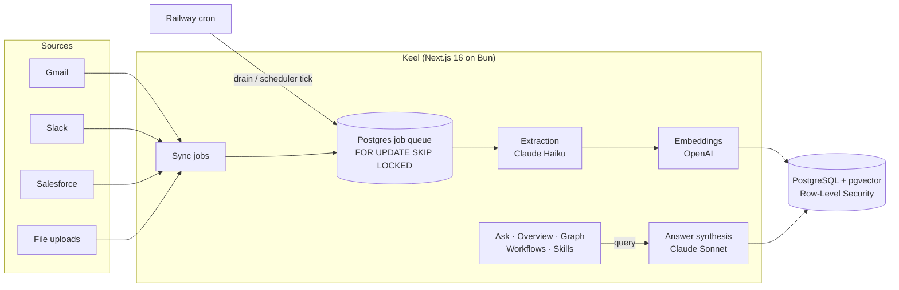

<div align="center">

# ⚓ Keel

**Your work life, kept steady.**

Keel connects to Gmail, Slack, Salesforce, and your files, turns the noise into a structured personal knowledge graph,
and keeps track of every promise you've made — so nothing slips.

[](https://nextjs.org)
[](https://react.dev)
[](https://www.typescriptlang.org)
[](https://github.com/pgvector/pgvector)
[](https://www.anthropic.com)
[](https://bun.sh)

</div>

---

## Why Keel?

Important context is scattered across inboxes, channels, and CRMs. You promise someone a follow-up in a Slack thread,
a customer asks for something in an email, a deal moves in Salesforce, and by Friday half of it is forgotten.

Keel reads those sources, extracts the **people, companies, projects, and commitments** inside them, and gives you:

- a **conversational assistant** that answers questions about *your* world, with citations back to the original message
- a **proactive daily brief** that tells you what's due, who's waiting on you, and what's gone quiet
- **automations you describe in plain English** ("every Monday, summarize open customer escalations")

A keel keeps a ship steady and on course. That's the job.

---

## Features

### 💬 Ask — grounded conversational search
- Streaming answers synthesized by Claude over a **pgvector** semantic index of everything you've synced
- Every claim is **cited** to the source email, Slack message, or document; invalid citations are detected and flagged
- Optional **web search** (Tavily) blended in when your own data isn't enough
- Dynamic openers and follow-up suggestions generated strictly from your data

### 🧠 Knowledge graph
- An LLM extraction pipeline turns raw messages into typed **pages** (person, company, project, …) with links between them
- Interactive **force-directed graph** to explore how people, threads, and projects connect
- Browse and edit every extracted page

### ✅ Promise tracking
- Detects **commitments** you've made ("I'll send the deck Thursday") and requests waiting on you
- Deduplicates repeated promises across sources and shows a detail drawer with the originating thread
- Mark done / dismiss; status feeds back into the daily brief

### 🌅 Proactive daily brief
- A bento-style overview: *Today's promises · Awaiting your reply · Active threads · Quiet but important*
- Generated on a schedule at the hour you choose, with a 30-day history of past briefs
- Thumbs-up/down feedback adapts what the brief surfaces

### ⚙️ Workflows & skills you write in English
- **Workflows**: scheduled AI agents with a trigger (cron preset or custom), a natural-language filter, and an action.
  Describe it in a sentence and an LLM drafts the full spec for you.
- **Skills**: reusable prompts you invoke in Ask with `/slash` autocomplete

### 🔌 Sources
| Source | How it connects |
|---|---|
| **Gmail** | Google OAuth (read-only scope), incremental sync |
| **Slack** | User-token OAuth across channels, DMs, and group DMs |
| **Salesforce** | Per-user Connected App OAuth; syncs Accounts, Contacts, and Cases |
| **Files** | Upload PDF, DOCX, XLSX, CSV, or text, parsed into the same pipeline |

### 💳 Bring-your-own-key billing
- Users can run on a shared trial budget or plug in their own Anthropic and OpenAI keys
- Per-user daily cost cap and a `/usage` dashboard showing spend by feature

---

## Architecture



### Engineering highlights

- **Multi-tenant isolation with Postgres Row-Level Security.** All tenant data lives in one database, and RLS policies on
  every table are the security wall. Each request runs inside `withUser()`, which sets `app.user_id` for the transaction
  under a non-superuser, `NOBYPASSRLS` role. A custom lint rule (`bun run lint:rls`) fails the build if any code touches
  tenant tables outside the approved modules, and a dedicated test suite verifies cross-user isolation.
- **Encryption at rest.** OAuth tokens, user API keys, and raw email and Slack content are encrypted with AES-256-GCM before
  they hit the database.
- **No-infra job queue.** Background work (syncs, extraction, digests, workflow runs) uses a Postgres-backed queue with
  `SELECT … FOR UPDATE SKIP LOCKED`, per-user concurrency caps, retries with backoff, and a stale-job reaper. No Redis,
  no separate broker.
- **Cost-aware LLM routing.** Cheap, high-volume extraction runs on Claude Haiku; user-facing synthesis runs on Claude Sonnet.
  Rate-limit handling, prompt trimming, and dedup keep spend predictable.
- **Grounded generation.** Prompts force answers to cite retrieved chunks, and citations are validated after generation
  so the UI can flag anything unsupported.

Deeper write-ups live in [`docs/`](./docs/INDEX.md), including an ADR-style
[design decision log](./docs/design-decisions.md).

---

## Tech stack

| Layer | Tech |
|---|---|
| Framework | Next.js 16 (App Router, Server Components, streaming), React 19 |
| Language / runtime | TypeScript, Bun |
| Styling | Tailwind CSS v4 |
| Auth | Auth.js v5 (Google OAuth) |
| Database | PostgreSQL 16 + pgvector, Row-Level Security |
| LLMs | Anthropic Claude (Haiku 4.5 for extraction, Sonnet 4.6 for synthesis) |
| Embeddings | OpenAI `text-embedding-3-large` |
| Web search | Tavily (optional) |
| Testing | Vitest |
| Deploy | Docker on Railway, with Railway cron for the queue and scheduler |

---

## Quick start

**Prerequisites:** [Bun](https://bun.sh), Docker (or [Colima](https://github.com/abiosoft/colima) on macOS), and OAuth
credentials for Google (plus Slack or Salesforce if you want those sources). You'll also need Anthropic and OpenAI API keys.

```bash
git clone https://github.com/vamshidhar199/keel.git keel
cd keel
bash setup.sh          # starts Postgres + pgvector in Docker, creates the app DB role, writes .env.local
# fill in OAuth + API keys in .env.local
bun install
bun run dev -- --port 3002
```

Open <http://localhost:3002> and sign in with Google. Migrations run automatically on first sign-in.

👉 The full walkthrough, covering Google Cloud, Slack app, and Salesforce Connected App setup plus troubleshooting, is in
**[docs/local-setup.md](./docs/local-setup.md)**. For production on Railway, see **[docs/deployment.md](./docs/deployment.md)**.

### Scripts

| Command | What it does |
|---|---|
| `bun run dev` | Start the dev server |
| `bun run build` | Production build |
| `bun run test` | Run the Vitest suite (including RLS isolation tests) |
| `bun run lint` | ESLint |
| `bun run lint:rls` | Guardrail that fails if tenant tables are queried outside approved modules |

---

## Project structure

```
.
├── app/
│   ├── (app)/                 # Authenticated shell
│   │   ├── ask/               # Streaming conversational search
│   │   ├── overview/          # Proactive daily-brief hub
│   │   ├── digests/           # Past briefs
│   │   ├── graph/             # Force-directed knowledge graph
│   │   ├── pages/             # Extracted knowledge pages
│   │   ├── workflows/         # Scheduled AI agents
│   │   ├── skills/            # Reusable /slash skills
│   │   ├── sources/           # Gmail · Slack · Salesforce · Files
│   │   ├── usage/             # LLM spend dashboard
│   │   └── settings/
│   ├── api/                   # Route handlers (OAuth, sync, queue, cron, query, …)
│   └── components/
├── lib/
│   ├── extract.ts             # LLM entity + commitment extraction
│   ├── synthesize.ts          # Cited answer synthesis
│   ├── gbrain.ts              # Page writes + pgvector search (RLS-scoped)
│   ├── queue/                 # Postgres job queue + runners
│   ├── sync.ts                # Source syncs + scheduler tick
│   ├── gmail.ts · slack.ts · salesforce.ts
│   ├── digest.ts · commitments.ts · workflows.ts · skills.ts
│   ├── crypto.ts              # Encryption at rest
│   ├── db.ts                  # Pools + withUser() RLS wrapper
│   └── migrate.ts             # Schema migrations
├── docs/                      # Architecture, features, deployment, roadmap
├── Dockerfile
└── railway.toml               # Deploy + cron config
```

---

## Roadmap

- Email and Slack delivery of the daily brief
- A dedicated worker process, separate from the web tier
- Object storage for raw payloads
- More sources (Calendar, Notion, Linear)

See [docs/intelligent-ui-roadmap.md](./docs/intelligent-ui-roadmap.md) and [docs/roadmap.md](./docs/roadmap.md).

---

<div align="center">
Built by <a href="https://github.com/vamshidhar199">@vamshidhar199</a>
</div>
